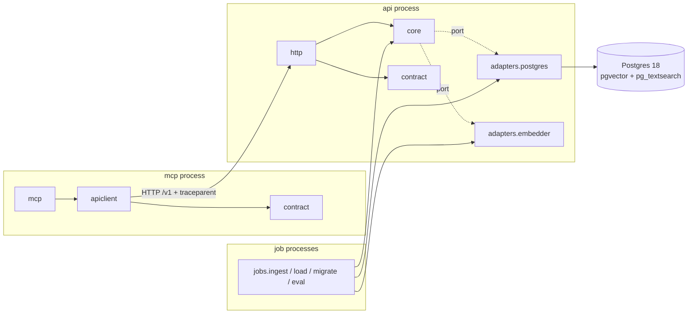
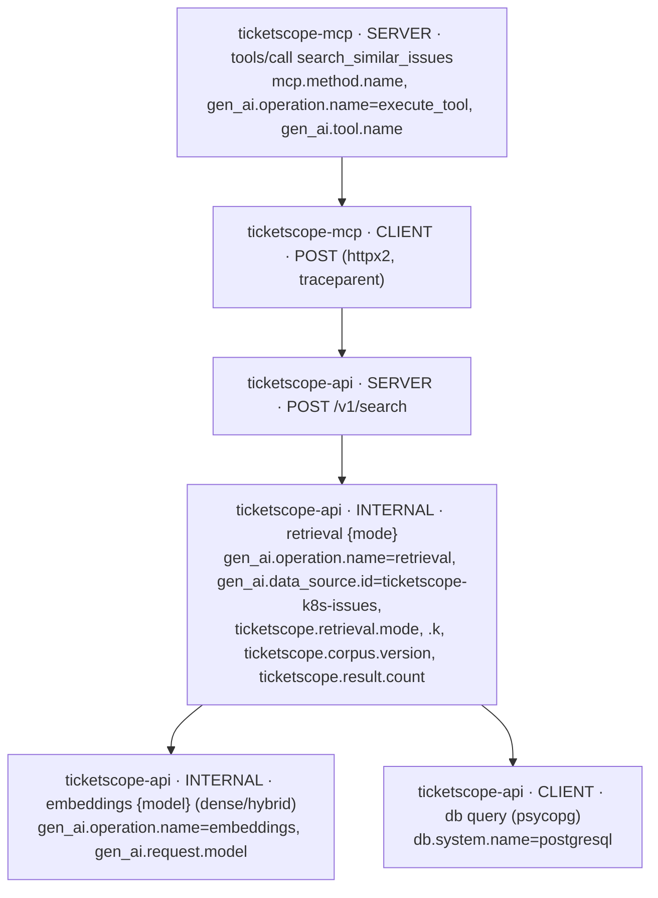
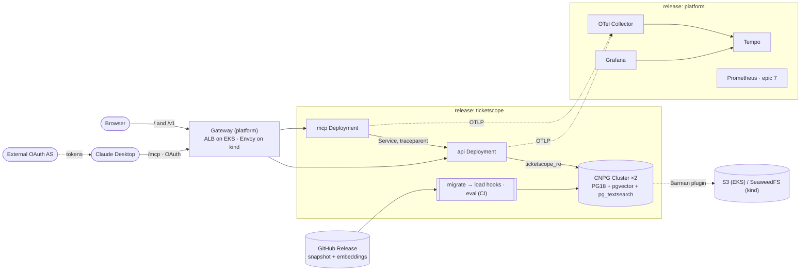
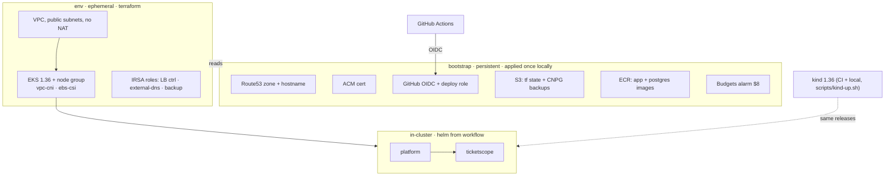
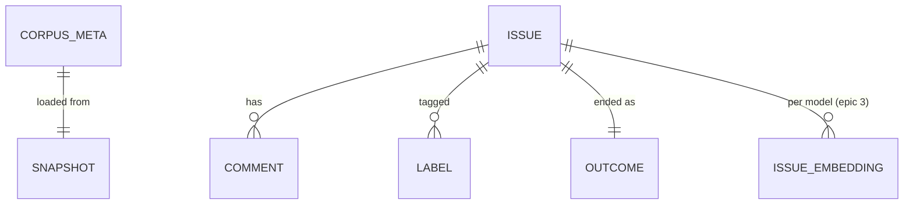

# Architecture Spine — ticketscope

## Design Paradigm

**Ports and adapters.**

- A pure `core` holds the retrieval modes, rank fusion, the result model and the derived-field functions.
- `core` reaches the outside only through two ports: `CorpusStore` and `Embedder`.
- The adapters (Postgres, embedding model, HTTP API and page, MCP) and the batch jobs (ingest, load, migrate, eval) are thin drivers around `core`.
- Each process has exactly one composition root, which wires the adapters into `core`.

| Layer | Package | May import |
| --- | --- | --- |
| Wire contract | `ticketscope.contract` | pydantic only |
| Core (domain + ports) | `ticketscope.core` | stdlib, pydantic |
| Driven adapters | `ticketscope.adapters.postgres`, `ticketscope.adapters.embedder` | core |
| Driving adapters | `ticketscope.http` (FastAPI + page) | core, contract |
| | `ticketscope.mcp`, `ticketscope.apiclient` | contract, apiclient (never core or adapters) |
| Jobs | `ticketscope.jobs.{ingest,load,migrate,eval}` | core, contract, driven adapters |
| Cross-cutting | `ticketscope.settings`, `ticketscope.telemetry` | stdlib, OTel, pydantic-settings |



## Invariants & Rules

### AD-1 — Dependency direction, enforced [ADOPTED]

- **Binds:** all epics
- **Prevents:** retrieval logic leaking into routes or MCP tools; eval measuring something other than the shipped retrieval path; adapters wired ad hoc in several places.
- **Rule:**
  - **Layering.** The layer table above is binding, and `ci.yml` enforces it with import-linter. `core` imports nothing from adapters, jobs, `http` or `mcp`, and every retrieval mode lives in `core` against the ports. `mcp` reaches retrieval only through `apiclient` over HTTP.
  - **Wiring.** Each process wires its adapters in one composition root: the `ticketscope.http.app` factory, `ticketscope.mcp.main`, or `ticketscope.jobs.<job>.main`.
  - **Eval.** Eval calls `core` through the real Postgres adapter, so its p95 includes the database and excludes HTTP.
  - **Fakes.** Both ports have in-repo fakes: an in-memory `CorpusStore` and a deterministic hash `Embedder`. Unit tests and the page then run with no database, no model and no cloud credentials.

### AD-2 — One language, one codebase [ADOPTED]

- **Binds:** all epics
- **Prevents:** a second toolchain splitting the image, CI and test setup.
- **Rule:** Every component (ingest, load, migrate, eval, api, mcp) is Python 3.14 in one uv-managed repo and ships in **one app image**. Each process is selected by its entrypoint command, not by a separate image.

### AD-3 — Runtime topology: `api` and `mcp` are separate Deployments [ADOPTED]

- **Binds:** epics 1, 3, 4, 5, 6, 7
- **Prevents:** MCP touching the database or re-implementing retrieval, and an R8 trace that never crosses a service boundary.
- **Rule:**
  - `api` serves the page and `/v1`. It is the only long-running process that holds a database connection or loads the embedding model.
  - `mcp` holds neither. It calls `api` only through its in-cluster Service, carrying W3C `traceparent`.
  - Both are stateless and safe at any replica count.

### AD-4 — Retrieval API contract `/v1` [ADOPTED]

- **Binds:** epics 1, 2, 3, 4 (R2, R5)
- **Prevents:** the page, MCP and eval coding to different result shapes, or reading `score` differently.
- **Rule:**
  - **The seam.** The contract below is the single seam. Within `/v1` only additive changes are allowed.
  - **Mode.** `mode` is validated against `core.modes.REGISTRY` (AD-19). If it is omitted, the server default applies (AD-25). An unknown `mode` returns 422.
  - **Errors.** Errors are RFC 9457 `application/problem+json`.
  - **Ordering and score.** `rank` is the only ordering contract. `score` is higher-is-better within one response and is not comparable across modes or queries. `score_kind` names its scale.
  - **`corpus_version`.** It comes from `corpus_meta` (AD-21).
  - **Outcome.** Epic 1 defines how `outcome` is derived. The shape and the enum are fixed here.

```text
POST /v1/search   { query: str, mode?: "keyword"|"dense"|"hybrid", k?: int = 10 (1..50) }
→ 200 { mode, score_kind: "bm25"|"cosine"|"rrf", corpus_version,
        results: [ { rank, score,
          issue:   { number, title, url, kind: "short"|"log_heavy", state },
          outcome: { status: "fixed"|"duplicate"|"not_planned"|"stale"|"answered"|"unknown",
                     summary: str|null, source: "label"|"linked_pr"|"closing_comment"|null,
                     ref: url|null } } ] }
GET  /v1/issues/{number}  → { issue (+ body), outcome }
```

### AD-5 — MCP mirrors the API; `mcp` is a resource server only [ADOPTED]

- **Binds:** epics 4, 6 (R4)
- **Prevents:** MCP inventing a second result shape, auth logic leaking into `api`, and an authorization server landing on the public host.
- **Rule:**
  - **Protocol.** `mcp` uses the official `mcp` SDK v2 (`MCPServer`) over stateless Streamable HTTP at `/mcp`. It serves protocol 2026-07-28 plus the SDK's handshake-era versions.
  - **Host check.** `transport_security.allowed_hosts` comes from values, so the gateway's host header is accepted.
  - **Tools.**
    - `search_similar_issues(query, mode?, k?)`: structured output is the `/v1/search` body.
    - `get_issue(number)`: structured output is the `GET /v1/issues/{number}` body.

    Both output schemas are generated from `ticketscope.contract` (AD-20).
  - **Auth.** `mcp` is an OAuth 2.1 **resource server only**. It validates tokens and serves `/.well-known/oauth-protected-resource`.
    - The authorization server is an **external hosted service**, never deployed on the cluster or behind the public host.
    - Auth is on or off per environment value (AD-25).
    - `api` trusts in-cluster callers and has no auth.

### AD-6 — The frozen corpus snapshot is the source of truth [ADOPTED]

- **Binds:** epics 1, 2, 3, 5 (R1, R6, R7, R10)
- **Prevents:** eval scores drifting with a live corpus, GitHub rate limits during spin-up, per-environment data drift, and epic 2 lacking the raw fields its labelled pairs need.
- **Rule:**
  - **Publishing.** `ingest` is the only component that calls the GitHub API. It runs on demand through `snapshot.yml` and publishes a **versioned snapshot** (`YYYY.MM.N`) as a GitHub Release asset.
  - **Fields.** The snapshot schema is versioned. For every issue it must carry: `number`, `title`, `body`, `state`, `state_reason`, `created_at`, `closed_at`, `labels`, and `comments` (each with `author_association`, `body` and `created_at`). It must also carry the timeline events, including `marked_as_duplicate` and cross-referenced or closing PRs.
  - **Loading.** Every environment gets its data only from `load` reading the snapshot version pinned in values.
  - **Restore drill.** The CNPG restore drill (AD-18) is separate from this spin-up path.

### AD-7 — Database write ownership, schema and roles [ADOPTED]

- **Binds:** epics 1, 2, 3, 5
- **Prevents:** two schema owners, migration races, `api` mutating the corpus, and a new table that `api` cannot read while eval, connected as the owner, can.
- **Rule:**
  - **Schema.** The schema evolves through one ordered track of plain SQL migrations in `migrations/`, applied only by the `migrate` Job (AD-22).
  - **Writer.** `load` is the **only writer** of corpus tables, embeddings included. `load` and `migrate` connect as the app owner role.
  - **Read-only role.** `api` and `eval` connect as `ticketscope_ro`, a CNPG `managed.roles` entry. Its Secret, `ticketscope-db-ro`, is generated once by the chart.
  - **Grants.** Migration `0001` sets `ALTER DEFAULT PRIVILEGES … GRANT SELECT ON TABLES TO ticketscope_ro`, so every later table is readable without a per-table grant.

### AD-8 — Derived fields are computed once, in `core`, at load [ADOPTED]

- **Binds:** epics 1, 2, 3 (R1, R6)
- **Prevents:** eval splitting by a different "kind" than the API reports, and two outcome derivations.
- **Rule:**
  - `kind` (`short` | `log_heavy`) and `outcome` are each computed by one function in `core`, called by `load`, and persisted.
  - The API, page and eval read the persisted values and never recompute them.
  - Changing either function requires a reload and a baseline update (AD-12).

### AD-9 — Keyword retrieval is BM25 via pg_textsearch, in Postgres [ADOPTED]

- **Binds:** epics 1, 3, 5 (R2, R3)
- **Prevents:** passing `ts_rank` off as BM25, and stateful in-app indexes in each replica.
- **Rule:**
  - **Engines.** Keyword mode ranks with **pg_textsearch** BM25 inside Postgres. Dense mode uses **pgvector**.
  - **Image.** Postgres runs from an in-repo image: the CloudNativePG `standard` PostgreSQL 18 image (pgvector included) plus the PGDG `pg_textsearch` package. The `Cluster` preloads pg_textsearch via `shared_preload_libraries`.
  - **One BM25 provider.** `pg_search` and `vchord_bm25` are excluded.
  - **Score sign.** pg_textsearch's negative scores are negated in the adapter, so `score` is higher-is-better (AD-4).
  - **Fusion.** Hybrid fusion runs in `core`.

### AD-10 — Span contract [ADOPTED]

- **Binds:** epics 1, 3, 4, 7 (R8, R9)
- **Prevents:** divergent span names, attributes or service names that break the one-trace demo and the span-derived dashboard.
- **Rule:**
  - **The tree.** The span tree below is binding. It follows the OTel GenAI and MCP semantic conventions (the `semantic-conventions-genai` repo).
  - **Opt-in.** Every process sets `OTEL_SEMCONV_STABILITY_OPT_IN=gen_ai_latest_experimental,database,http`, with OTel instrumentation ≥ 0.66b2.
  - **Service names.** `service.name` is exactly `ticketscope-api`, `ticketscope-mcp` or `ticketscope-jobs`.
  - **Propagation.**
    - `apiclient` uses `httpx2`, the `mcp` SDK's client, with OTel httpx instrumentation.
    - `mcp` continues the caller's trace context from the MCP request `_meta` when it is present.
  - **Attributes.** Custom attributes live only under `ticketscope.*`. Query text is recorded only when a value opts in.
  - **Errors.** Errors set span status `ERROR`.
  - **Export.** Export is OTLP to the in-cluster collector, and nowhere else.



### AD-11 — Telemetry pipeline: traces only, metrics derived from spans [ADOPTED]

- **Binds:** epics 1, 4, 7, 8 (R8, R9, R12)
- **Prevents:** the R12 trace screenshot depending on the first-cut epic, and hand-written metrics drifting from the spans.
- **Rule:**
  - **Epic 1.** The `platform` release ships the OTel Collector, Tempo and Grafana (Explore view over Tempo).
  - **Apps.** Apps emit traces and JSON logs only.
  - **Epic 7.** Epic 7 adds the collector's `spanmetrics` connector, Prometheus and the one dashboard. The connector's dimensions are `service.name`, `span.name`, `span.kind`, `status.code`, `ticketscope.retrieval.mode` and `gen_ai.tool.name`.
  - **Dashboard.** Every panel derives from AD-10 spans and excludes `ticketscope-jobs`.

### AD-12 — Eval gate and data lineage [ADOPTED]

- **Binds:** epics 2, 3, 8 (R6, R7, R12)
- **Prevents:** flaky latency blocks, invisible baseline drift, and comparing scores across corpora or models.
- **Rule:**
  - **Pairs.** Epic 2 derives labelled duplicate pairs deterministically from the snapshot and commits them as `eval/pairs/<snapshot>.jsonl`.
  - **Gate.** `eval.yml` is a required PR check. It gates Recall@k and MRR for each mode and ticket kind against the committed `eval/baseline.json`, within a small epsilon. Latency p95 is reported and never gated.
  - **Baseline lineage.** `baseline.json` records the snapshot version, the embedding model id and the preprocessing version. A PR that changes any of them, or that intentionally moves scores, updates `baseline.json` in the same diff.
  - **README table.** It is generated from the CI results artifact and never edited by hand.

### AD-13 — Two Helm releases, identical on kind and EKS [ADOPTED]

- **Binds:** epics 1, 4, 5, 7 (R11)
- **Prevents:** operator and CRD ordering breakage, and kind/EKS chart drift.
- **Rule:** Two releases are installed the same way in every environment.
  - **`platform`**:
    - Gateway API CRDs and the one `Gateway`
    - the GatewayClass implementation: Envoy Gateway with cloud-provider-kind on kind; the AWS Load Balancer Controller on EKS
    - external-dns, on EKS only
    - the CNPG operator and the Barman Cloud Plugin
    - SeaweedFS as the S3-compatible backup target, on kind only
    - the OTel Collector, Tempo and Grafana
    - Prometheus, added by epic 7
  - **`ticketscope`**: `api`, `mcp`, the CNPG `Cluster`, the `migrate`, `load` and `eval` Jobs, and the `HTTPRoute`s.

  The `ticketscope` chart uses no AWS-only feature, so the kind-only fallback survives an EKS cut.

### AD-14 — Exposure through the Gateway API: one public host, fixed route table [ADOPTED]

- **Binds:** epics 1, 4, 5, 6, 7 (R4, R5, R10)
- **Prevents:** a dependency on the retired ingress-nginx, two Gateways or two ALBs, OAuth metadata routed to the wrong service, and `mcp`→`api` traffic over the public edge.
- **Rule:**
  - **No `Ingress`.** The `ticketscope` chart ships only `HTTPRoute`s, attached to the `platform` Gateway, with this fixed route table:

    | Path | Service |
    | --- | --- |
    | `/`, `/v1` | `api` |
    | `/mcp`, `/.well-known/oauth-protected-resource` | `mcp` |

  - **Hostname.** The hostname is set on the listener and the routes. On EKS, the ALB picks up the bootstrap ACM certificate by that hostname, and external-dns writes the record into the bootstrap zone.
  - **Not public.** Grafana, Tempo and SeaweedFS are never public; reach them by port-forward.

### AD-15 — Terraform: persistent `bootstrap`, ephemeral `env` [ADOPTED]

- **Binds:** epics 5, 6, 8 (R10, R11)
- **Prevents:** hostname and certificate churn breaking OAuth redirects and the Claude Desktop connector, and images vanishing on destroy.
- **Rule:**
  - **`bootstrap`** is persistent and applied once by the author locally. It holds:
    - the Route53 zone and the fixed hostname, plus the ACM certificate
    - the GitHub OIDC provider and the deploy role
    - the S3 bucket for Terraform state and CNPG backups, with a lifecycle rule
    - the ECR repositories, keeping the last 10 images
    - an AWS Budgets alarm at $8/month
  - **`env`** is ephemeral (AD-23 and AD-24).
  - **What "destroy" means.** "Destroy leaves nothing billing" means that once `env` is destroyed, only `bootstrap` remains, at cents a month. R10 has to say so (ticket update).

### AD-16 — Images: multi-arch, SHA-tagged; Kubernetes 1.36 everywhere [ADOPTED]

- **Binds:** epics 1, 5
- **Prevents:** Graviton nodes unable to run amd64-only images, CNPG on an untested Kubernetes minor, and kind/EKS skew.
- **Rule:**
  - **Images.** The app image (AD-2) and the Postgres image (AD-9) are each built for `linux/amd64` and `linux/arm64` and tagged with the git SHA.
  - **Registries.** kind gets images through `kind load docker-image`. EKS pulls them from bootstrap ECR.
  - **Versions.** EKS and the kind node image are both pinned to Kubernetes 1.36, on standard support only.
  - **Excluded.** No EKS Auto Mode, no Fargate.

### AD-17 — CI/CD workflow layout [ADOPTED]

- **Binds:** epics 1, 2, 4, 5 (R7, R11)
- **Prevents:** each epic inventing its own kind setup or deploy path.
- **Rule:** One workflow per concern. `scripts/kind-up.sh` is the only kind bring-up, used both locally and by `_kind-deploy.yml`.

| Workflow | Trigger | Does |
| --- | --- | --- |
| `ci.yml` | PR | lint, types, import-linter, unit tests |
| `_kind-deploy.yml` | `workflow_call` | build images → `scripts/kind-up.sh` → install `platform` + `ticketscope` |
| `eval.yml` | PR (required) | `_kind-deploy` → eval Job → gate + results artifact |
| `mcp-e2e.yml` | PR | `_kind-deploy` → MCP client test against `/mcp` |
| `snapshot.yml` | dispatch | ingest → Release asset |
| `env-up.yml` | dispatch | via OIDC: push images → terraform `env` apply → helm `platform` + `ticketscope` → record wall-clock duration |
| `env-down.yml` | dispatch + schedule | the ordered teardown in AD-24 |

### AD-18 — Backups and drills through the Barman Cloud Plugin [ADOPTED]

- **Binds:** epics 1, 5, 8 (R3)
- **Prevents:** building on the in-tree `barmanObjectStore` (removed in CNPG 1.32), static backup keys, and losing the R3 drills if EKS is cut.
- **Rule:**
  - **Cluster.** The `Cluster` runs `instances: 2` in every environment.
  - **Backups.** It backs up through the Barman Cloud Plugin to an S3-compatible endpoint taken from values:
    - on EKS, the bootstrap bucket, through an IRSA role created in the `env` stack;
    - on kind, SeaweedFS.
  - **Drills.** The restore drill and the failure drill are recorded on EKS, or on kind if epic 5 is cut.

### AD-19 — Retriever port and mode registry [ADOPTED]

- **Binds:** epics 1, 2, 3 (R2, R6)
- **Prevents:** eval hard-coding modes, mismatched mode signatures, and the query issue scoring itself as a hit.
- **Rule:**
  - **Interface.** Every mode implements `Retriever.search(query: str, k: int, exclude: frozenset[int] = frozenset()) -> list[Scored]` and registers itself in `core.modes.REGISTRY`.
  - **Consumers.** `/v1` validates `mode` against the registry. Eval iterates the registry, skips any mode whose `available(store)` is false, and passes the query issue in `exclude`.
  - **Hybrid.** Hybrid fetches at least `k + |exclude|` candidates from each side.

### AD-20 — One wire contract module [ADOPTED]

- **Binds:** epics 1, 3, 4 (R2, R4)
- **Prevents:** duplicated response models in `apiclient` that reject or drop fields added within `/v1`.
- **Rule:** The `/v1` request and response models are defined once, in `ticketscope.contract`. `http`, `apiclient` and `eval` import them, and the MCP output schemas are generated from them. The models allow unknown fields and pass them through.

### AD-21 — `corpus_meta` and embedding storage [ADOPTED]

- **Binds:** epics 1, 3, 5 (R2, R10)
- **Prevents:** `corpus_version` meaning different things in different places, `api` querying with a different model than `load` used, a fixed-dimension column breaking on a model change, and a 30-minute spin-up spent on embedding.
- **Rule:**
  - **`corpus_meta`.** `load` writes one `corpus_meta` row: `snapshot_version`, `embedding_model_id`, `preprocessing_version`, `loaded_at`. `api` reads `corpus_version` from that row, and fails readiness if its configured model id differs from `embedding_model_id`.
  - **`issue_embedding`.** Embeddings live in an `issue_embedding` table keyed by `(issue_number, model_id)`. Epic 3 owns the table, through AD-7's migration track.
  - **Precomputed embeddings.** They are Release assets keyed by `(snapshot, model, preprocessing)`, and `env-up` never computes embeddings. `load` may compute them only on kind, and only when the asset is absent.

### AD-22 — Install and data-load order [ADOPTED]

- **Binds:** epics 1, 2, 5 (R10, R11)
- **Prevents:** `migrate` running before the database exists, and Job-immutability failures on upgrade.
- **Rule:** The order below is binding.

  1. `platform` is installed.
  2. The `ticketscope` release creates the `Cluster`.
  3. `migrate` runs as a post-install/pre-upgrade hook that waits for the `Cluster` to be ready.
  4. `load` runs as a post-install/post-upgrade hook. It is idempotent against `corpus_meta`: if the snapshot, model and preprocessing are unchanged, it does nothing.
  5. `api` and `mcp` become Ready.

  The `eval` Job is rendered only when `eval.enabled` is set, which is in CI.

### AD-23 — Terraform owns AWS resources; Helm owns everything in-cluster [ADOPTED]

- **Binds:** epics 5, 6, 7
- **Prevents:** controllers installed twice, once by Terraform and once by the workflow, and in-cluster resources that Terraform state cannot see.
- **Rule:**
  - **Terraform `env`.** It owns only AWS resources:
    - a VPC with public subnets and no NAT
    - EKS and its node group
    - the EKS managed add-ons (vpc-cni, ebs-csi)
    - the IRSA roles for the LB controller, external-dns and CNPG backup
  - **Helm.** Every Helm release is installed by the workflow with `helm`, never by Terraform `helm_release`.
  - **Excluded.** No customer-managed KMS key. EKS control-plane logging is off.

### AD-24 — Teardown order and cost guardrails [ADOPTED]

- **Binds:** epics 5, 8 (R10, ticket cost constraint)
- **Prevents:** controller-created ALBs, ENIs and EBS volumes outliving `terraform destroy`, and a forgotten environment exceeding $10/month.
- **Rule:**
  - **Teardown order.** `env-down.yml` runs:
    1. `helm uninstall ticketscope`
    2. delete the PVCs
    3. `helm uninstall platform`
    4. wait until the tagged ALB, ENIs and EBS volumes are gone
    5. `terraform destroy` the `env` stack
    6. run a tag-scoped leftover check, which fails the job if anything but `bootstrap` remains
  - **Expiry.** `env-up` stamps an expiry, 4 hours by default. A scheduled run of `env-down.yml` tears down any expired environment.
  - **Budget.** About 25 env-hours a month.

### AD-25 — Chart values ownership [ADOPTED]

- **Binds:** epics 3, 4, 5, 6, 7
- **Prevents:** an environment file silently overriding product defaults, and `mcp` growing its own default mode.
- **Rule:**
  - **`values.yaml`.** It holds every default, including the retrieval default mode and the `api` resources. Epic 3 owns those keys.
  - **Environment files.** `values-kind.yaml` and `values-eks.yaml` hold only environment facts: hostname, gateway class, storage class, backup endpoint, auth on/off and issuer, and replica counts.
  - **`mcp`.** It has no mode default of its own.

## Consistency Conventions

| Concern | Convention |
| --- | --- |
| Naming | Python packages `ticketscope.*`; K8s resources `ticketscope-<component>`; custom span attributes `ticketscope.*`; MCP tools `snake_case` verbs |
| Identifiers | An issue is keyed by its GitHub issue number (single repo `kubernetes/kubernetes`); the corpus is identified by snapshot version `YYYY.MM.N` |
| Dates & formats | RFC 3339 UTC; JSON field names `snake_case` |
| Errors | RFC 9457 problem+json from `api`; MCP tool errors set `is_error` with the problem `detail`; spans set status `ERROR` |
| Config | Only `TICKETSCOPE_*` env vars, read by one pydantic-settings module per process; chart values map to env vars; no config files in images |
| Logging | JSON lines to stdout with `trace_id`/`span_id` |
| Secrets | K8s Secrets generated by CNPG or the chart; never committed or placed in values; no stored cloud keys (GitHub OIDC, IRSA) |
| Provenance | Public GitHub issues only; nothing from youscope (names, identifier keys, DB, logs, `.env`), and no real team or employer names |
| Wording | "a personal project, deployed and operated on Kubernetes", never "production"; no "vector database" in outward README text without a claims-ledger row |

## Stack

| Name | Version |
| --- | --- |
| Python / uv | 3.14 / 0.13 |
| FastAPI / Pydantic | 0.162 / 2.14 |
| `mcp` (official Python SDK) / httpx2 | 2.3 / 2.16 |
| psycopg / pgvector-python | 3.3 / 0.5 |
| fastembed / onnxruntime | 0.9 / 1.31 |
| opentelemetry-sdk / instrumentation / otelcol-contrib | 1.45 / ≥0.66b2 / 0.164 |
| import-linter | 2.15 |
| PostgreSQL / pgvector / pg_textsearch | 18 / 0.8.7 / 1.5.1 |
| CloudNativePG / Barman Cloud Plugin | 1.30 / 0.15 |
| Kubernetes (EKS + kind node) / kind / cloud-provider-kind | 1.36 / 0.33 / 0.12 |
| Helm / Terraform / terraform-aws-modules/eks | 4.3 / 1.17 / 21 |
| AWS Load Balancer Controller / Envoy Gateway / external-dns | 3.6 / 1.9 / 0.24 |
| Tempo / Grafana | 3.1 / 13.3 |
| SeaweedFS (kind backup target) | 4.52 |

## Structural Seed







```text
ticketscope/
  src/ticketscope/
    contract/        # /v1 wire models (AD-20)
    core/            # modes + REGISTRY, fusion, kind/outcome functions, ports, fakes
    adapters/        # postgres, embedder
    http/            # FastAPI app factory + the one page
    mcp/             # MCPServer tools
    apiclient/       # httpx2 /v1 client used by mcp
    jobs/            # ingest, load, migrate, eval
    settings.py  telemetry.py
  migrations/        # ordered plain SQL (AD-7)
  eval/              # baseline.json, pairs/<snapshot>.jsonl, report → README table
  images/            # app.Dockerfile, postgres.Dockerfile
  deploy/charts/     # platform/, ticketscope/ (+ values-kind.yaml, values-eks.yaml)
  infra/             # bootstrap/, env/
  scripts/           # kind-up.sh
  .github/workflows/ # AD-17
  docs/adr/          # 2–3 decision records (epic 8)
```

## Capability → Architecture Map

| Capability | Lives in | Governed by |
| --- | --- | --- |
| R1 ingest, both ticket kinds, outcomes | `jobs.ingest` → snapshot → `jobs.load`; `core` kind/outcome | AD-6, AD-7, AD-8 |
| R2 keyword / dense / hybrid retrieval | `core` modes over `adapters.postgres`, `/v1/search` | AD-1, AD-4, AD-9, AD-19, AD-20, AD-21 |
| R3 pgvector on CNPG, backups, drills | CNPG `Cluster`, Barman plugin | AD-9, AD-13, AD-18 |
| R4 remote MCP, authenticated | `mcp` Deployment, `/mcp` | AD-3, AD-5, AD-14, AD-15 |
| R5 one search page | `http` in `api` | AD-4, AD-14 |
| R6 eval by mode × kind | `jobs.eval`, `eval/` | AD-1, AD-8, AD-12, AD-19 |
| R7 gate on every PR, table from CI | `eval.yml` | AD-12, AD-17 |
| R8 one trace MCP → retrieval → DB | `telemetry`, collector, Tempo | AD-3, AD-10, AD-11 |
| R9 Grafana dashboard | `platform` (epic 7) | AD-11 |
| R10 apply < 30 min, destroy clean, < $10/mo | `infra/env`, `env-up/down.yml` | AD-15, AD-21, AD-22, AD-23, AD-24 |
| R11 Helm, OIDC deploys, same chart on kind | `deploy/charts`, workflows | AD-13, AD-16, AD-17, AD-25 |
| R12 README package | `docs/`, README, CI artifact | AD-11, AD-12 |
| R13 claims ledger | outside repo | Wording convention |

## Deferred

- **Outcome derivation rules** (label, linked PR or closing comment): epic 1. The shape and owner are fixed by AD-4 and AD-8.
- **The `short`/`log_heavy` threshold and the pair-extraction heuristics**: epics 1 and 2, under AD-8 and AD-12.
- **Snapshot file encoding and corpus size**: epic 1. The size must fit the 30-minute budget (AD-21).
- **Embedding model, dimension and preprocessing**: epic 3, chosen by a scored eval behind the `Embedder` port. fastembed/ONNX is the default runtime.
- **Hybrid fusion method and weights, and the post-epic-3 default mode**: epic 3, decided by AD-12 scores.
- **OAuth provider and CIMD settings**: epic 6, under AD-5's external-AS rule. The settings are `client_id_metadata_document_supported`, `token_endpoint_auth_methods` `none`, and the Claude callback `claude.ai/api/mcp/auth_callback`.
- **Tunnel for kind before EKS**: epic 4, using a named tunnel. Cloudflare quick tunnels lack SSE and get a random hostname each time.
- **Node instance types, spot vs on-demand, and chart resource values**: epic 5 and epic 3 (AD-25).
- **Out of scope**: a youscope-style non-ML recommender (keyword BM25 is the baseline), an eval of tool-call behaviour, a second vector store, and server-side LLM generation.

### Open questions

- **Corpus terms.** May GitHub issue text be stored and republished as a public Release asset and demo index? Owner: epic 1. Revisit before `snapshot.yml` first publishes.
- **AWS account plan and credits.** Owner: epic 5. Revisit before the first `env-up`.
- **Ground truth volume, corpus fit, and the embedding-model choice.** These stay on the initiative ticket. They don't change any AD.
